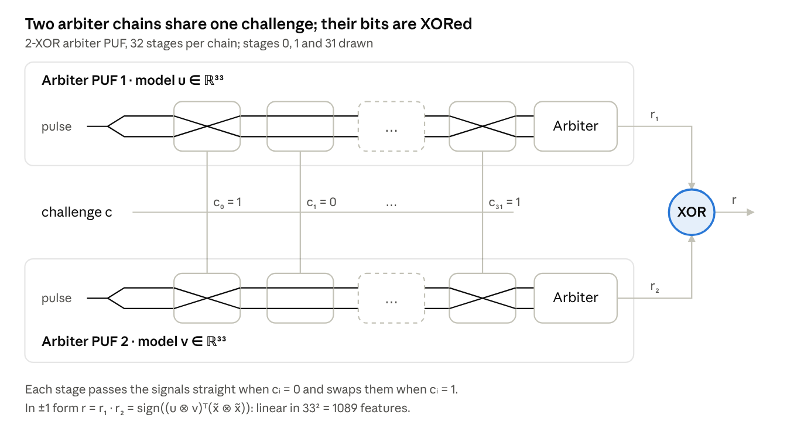
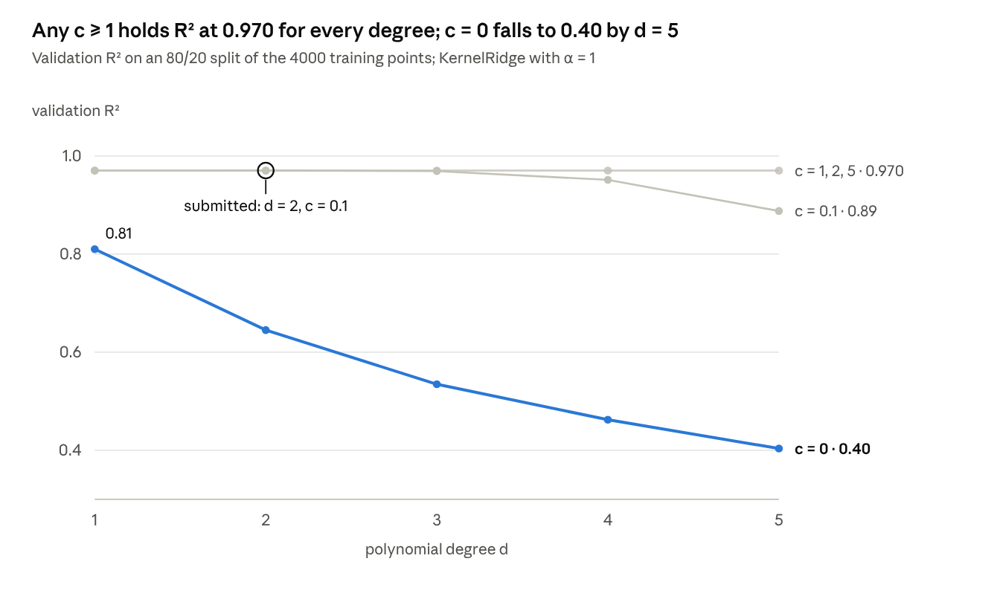
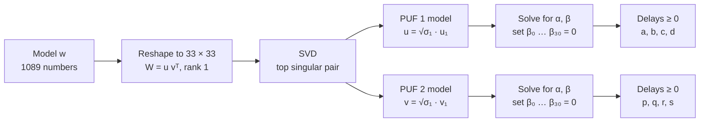

<div align="center">

# Decoding XOR PUFs

**Kernel design and rank-1 model inversion for hardware fingerprints**

Major Assignment 1 · CS771 Introduction to Machine Learning · IIT Kanpur · 2025–26 Semester I




</div>

Physically unclonable functions (PUFs) give each chip a fingerprint from tiny manufacturing variations. This project solves two problems from the assignment. The first is a regression problem; the second inverts the linear model of an XOR arbiter PUF back into physical circuit delays. Both come down to the same move: lift the problem into a space where it becomes linear algebra.

| | Problem 1 · Semi-parametric regression | Problem 2 · XOR PUF delay recovery |
| --- | --- | --- |
| **Task** | Fit y = w(z)·x + b, where the slope w(z) is non-linear, using only `KernelRidge` | Recover 256 non-negative delays that regenerate a 1089-dimensional XOR arbiter PUF model |
| **Key idea** | Fold x and the bias into the feature map, giving the kernel x₁x₂(z₁ᵀz₂ + c)ᵈ + 1 | The model is the Kronecker product of two arbiter PUFs, so it reshapes to a rank-1 matrix |
| **Method** | Kernel ridge regression with d = 2 and c = 0.1, confirmed by 5-fold cross-validation | SVD, then a closed-form inversion of each arbiter PUF |
| **Result** | **R² = 0.970** on the public test set, at the noise ceiling | **Reconstruction error 5.9 × 10⁻¹⁶**, 0.27 ms per model |

## Contents

- [Problem 1: a kernel for semi-parametric regression](#problem-1-a-kernel-for-semi-parametric-regression)
- [Problem 2: inverting an XOR arbiter PUF](#problem-2-inverting-an-xor-arbiter-puf)
- [Evaluation](#evaluation)
- [Getting started](#getting-started)
- [Repository structure](#repository-structure)
- [Notes](#notes)
- [Team](#team)
- [References](#references)

## Problem 1: a kernel for semi-parametric regression

**Setup.** The number of staff y needed to produce a video is proportional to its length x, but the rate depends non-linearly on z = (popularity, difficulty) ∈ [0, 1]²:

```math
y = w(z)\,x + b, \qquad w(z) = p^\top \phi(z), \qquad \phi(z_1)^\top \phi(z_2) = (z_1^\top z_2 + c)^d
```

The grader trains scikit-learn's `KernelRidge` on our Gram matrix. `KernelRidge` fits no intercept, so the whole model, bias included, has to be expressed as a single kernel.

**Derivation.** Put x inside the feature map and append a constant feature for the bias:

```math
\psi(x, z) = \begin{bmatrix} x\,\phi(z) \\ 1 \end{bmatrix}, \qquad \tilde{p} = \begin{bmatrix} p \\ b \end{bmatrix} \quad\Rightarrow\quad \tilde{p}^\top \psi(x, z) = x\,p^\top \phi(z) + b
```

```math
\tilde{K}\big((x_1, z_1), (x_2, z_2)\big) = \psi(x_1, z_1)^\top \psi(x_2, z_2) = x_1 x_2\,(z_1^\top z_2 + c)^d + 1
```

K̃ is an inner product of explicit features, so it is a valid (positive semidefinite) kernel. The implementation is two matrix products and no Python loops:

```python
K_x = X1 @ X2.T                 # x1 * x2 for every pair of points
K_z = (Z1 @ Z2.T + 0.1) ** 2    # polynomial kernel on z with c = 0.1, d = 2
G = K_x * K_z + 1.0             # the + 1 is the bias feature
```

**Choosing d and c.** We searched d ∈ {1, …, 5} and c ∈ {0, 0.1, 1, 2, 5}:

<p align="center">

</p>

To check that one split wasn't misleading, we re-ran the grid with 5-fold cross-validation (`experiments/kernel_grid_search.py`). Mean R² across folds; for c ≥ 0.1 the fold standard deviation is about 0.003:

| d | c = 0 | c = 0.1 | c ∈ {1, 2, 5} |
| :---: | :---: | :---: | :---: |
| 1 | 0.787 | 0.9709 | 0.9709 |
| **2** | 0.598 | **0.9710** | 0.9710 |
| 3 | 0.476 | 0.9689 | 0.9710 |
| 4 | 0.399 | 0.9479 | 0.9710 |
| 5 | 0.342 | 0.8776 | 0.9710 |

The submitted setting (d = 2, c = 0.1) scores 0.97099. The best setting (d = 2, c = 1) scores 0.97103, a gap of 0.01 fold standard deviations: a statistical tie.

<details>
<summary><b>Why the grid looks like this</b></summary>

<br>

Expanding the polynomial kernel shows how c weights the lower-degree terms:

```math
(z^\top z' + c)^d = \sum_{j=0}^{d} \binom{d}{j}\, c^{\,d-j}\, (z^\top z')^{j}
```

- **c = 0 fails, and gets worse as d grows.** The kernel keeps only degree-d monomials, so it cannot represent the large constant part of w(z).
- **c = 0.1 drops at high degree.** The constant feature has scale c^(d/2), only 0.003 at d = 5, so ridge regularization makes it too expensive to use.
- **Everything else plateaus at 0.970, the noise ceiling.** The residual standard deviation is 4.4 staff against a target standard deviation of 25.3, and 1 − (4.4/25.3)² ≈ 0.970. Train and test R² match (0.971 vs 0.970), so extra model capacity cannot help.

</details>

**Baselines** on the public test set show where the accuracy comes from:

| Model | Test R² |
| --- | :---: |
| Kernel ridge, submitted kernel (d = 2, c = 0.1) | **0.970** |
| Linear regression on the explicit features x·[1, z₁, z₂, z₁², z₁z₂, z₂²] | 0.970 |
| Linear regression on x, z₁, z₂ | 0.957 |
| Linear regression on x alone | 0.907 |
| Kernel ridge without the + 1 bias feature | 0.470 |

The x·z interaction lifts R² from 0.957 to 0.970, and the + 1 is essential: without it every prediction passes through y = 0 at x = 0, while the fitted intercept is about 39 staff. For d = 2 the kernel is a 7-feature linear model in disguise. The explicit version fits in milliseconds, while kernel ridge regression solves a 4000 × 4000 system; the assignment required the kernel form.

## Problem 2: inverting an XOR arbiter PUF

**Background.** An arbiter PUF races two signals through k multiplexer stages. Each challenge bit cᵢ sets its stage to straight or crossed, and an arbiter reports which signal arrived first. Under the additive delay model, the response is a linear classifier on transformed challenge bits:

```math
r = \operatorname{sign}\Big(\sum_{i=0}^{k-1} w_i\,x_i + w_k\Big), \qquad x_i = \prod_{j=i}^{k-1} (1 - 2c_j)
```

<details>
<summary><b>Where the weights come from</b></summary>

<br>

Each stage has four delays pᵢ, qᵢ, rᵢ, sᵢ. With dᵢ = 1 − 2cᵢ, the delay difference evolves as Δᵢ = dᵢΔᵢ₋₁ + dᵢαᵢ + βᵢ, and unrolling the recursion gives:

```math
\alpha_i = \tfrac{1}{2}(p_i - q_i + r_i - s_i), \qquad \beta_i = \tfrac{1}{2}(p_i - q_i - r_i + s_i)
```

```math
w_0 = \alpha_0, \qquad w_i = \alpha_i + \beta_{i-1} \ \ (1 \le i \le k-1), \qquad w_k = \beta_{k-1}
```

</details>

An XOR arbiter PUF feeds the same challenge to two arbiter PUFs, with models u and v, and XORs their bits. Writing bits as ±1 turns XOR into multiplication, and the product of two linear functions is linear in pairwise products of the features, with x̃ = [x; 1]:

```math
\operatorname{sign}(u^\top \tilde{x}) \cdot \operatorname{sign}(v^\top \tilde{x}) = \operatorname{sign}\big((u \otimes v)^\top (\tilde{x} \otimes \tilde{x})\big)
```

For two 32-stage PUFs this gives a linear model w = u ⊗ v with 33² = 1089 weights. The task: given w, find non-negative delays for both PUFs that regenerate w exactly.

**Key insight.** Reshaped to 33 × 33, entry (i, j) of w is uᵢvⱼ, so the matrix is W = u vᵀ: an outer product, hence rank 1. All 10 public models confirm it, with σ₂/σ₁ below 1.2 × 10⁻¹⁶. `my_decode` runs the forward model backwards:



1. **De-Kronecker.** The top singular triplet of W gives u = √σ₁·u₁ and v = √σ₁·v₁. SVD is exact for a rank-1 matrix and returns the best rank-1 fit if the model is noisy (Eckart–Young).
2. **Solve each arbiter PUF.** Each model gives 33 equations in 64 unknowns (αᵢ, βᵢ). Fixing β₀ … β₃₀ = 0 leaves αᵢ = wᵢ for i ≤ 31 and β₃₁ = w₃₂, an exact solution in O(k).
3. **Recover non-negative delays.** The definitions give pᵢ − qᵢ = αᵢ + βᵢ and rᵢ − sᵢ = αᵢ − βᵢ. Assign each difference's positive part to one delay and its negative part to the other:

```math
p_i = \max(\alpha_i + \beta_i,\, 0), \quad q_i = \max(-(\alpha_i + \beta_i),\, 0), \quad r_i = \max(\alpha_i - \beta_i,\, 0), \quad s_i = \max(-(\alpha_i - \beta_i),\, 0)
```

Every step inverts exactly, so the rebuilt model matches the input to floating-point precision: a mean error of 5.9 × 10⁻¹⁶ and a worst case of 1.1 × 10⁻¹⁵ across the 10 public models, with no negative delays. The recovered delays are not the chip's true delays, which cannot be identified from w: the scale can shift between u and v, the (α, β) system has a 31-dimensional null space, and each delay pair can share any offset. The assignment therefore asks for any delays that regenerate the model.

## Evaluation

The course evaluation notebook ([`eval_major_assn_1_2_25_26_I.ipynb`](eval_major_assn_1_2_25_26_I.ipynb)) averages each measure over 5 trials on the provided data. A fresh top-to-bottom run gives:

| Measure | Result |
| --- | :---: |
| Time to compute the train and test Gram matrices | 0.28 s |
| `KernelRidge` training time | 0.43 s |
| Test R² | **0.96995** |
| Decoding time per model | 0.27 ms |
| Distance between input and rebuilt model | **5.9 × 10⁻¹⁶** |

Timings depend on the machine. The test suite also checks the kernel against its explicit feature map, confirms that it is symmetric and positive semidefinite, and round-trips the decoder on the public models and on random delays.

## Getting started

```bash
git clone https://github.com/prakharkaushal/Decoding-XOR-PUF-s.git
cd Decoding-XOR-PUF-s
pip install -r requirements.txt

python tests/test_submit.py                # 6 tests; also runs under pytest
python experiments/kernel_grid_search.py   # grid search + 5-fold CV, about 2 minutes
```

Use the solution directly:

```python
import numpy as np
from submit import my_decode

w = np.loadtxt("src/public_mod.txt")[0]       # one 1089-dimensional XOR PUF model
a, b, c, d, p, q, r, s = my_decode(w)         # eight non-negative 32-dim delay vectors
```

The evaluation notebook needs Jupyter (`pip install notebook`) and must be run from the repository root.

## Repository structure

```
.
├── submit.py                           # the graded solution: my_kernel() and my_decode()
├── eval_major_assn_1_2_25_26_I.ipynb   # course evaluation notebook
├── Report.pdf                          # submitted report: derivations and grid search
├── experiments/
│   └── kernel_grid_search.py           # reproduces the report's grid, adds 5-fold CV
├── tests/
│   └── test_submit.py                  # kernel and decoder tests
├── assets/                             # figures for this README
├── src/
│   ├── Major Assignment 1-2 - CS771 2025-26-I.pdf   # problem statement
│   ├── public_{x,Z,y}_{trn,tst}.txt    # regression data: 4000 train, 1000 test points
│   ├── public_mod.txt                  # 10 XOR arbiter PUF models, 1089 numbers each
│   └── dummy/                          # copies of the data used by the evaluation notebook
└── requirements.txt
```

## Notes

- **Report errata.** Section 4.1 of `Report.pdf` writes αᵢ = pᵢ − qᵢ and βᵢ = rᵢ − sᵢ. The definitions used in Section 4.3 and in the code are αᵢ = (pᵢ − qᵢ + rᵢ − sᵢ)/2 and βᵢ = (pᵢ − qᵢ − rᵢ + sᵢ)/2.
- **Grid-search scores.** The report's grid-search figure is labelled "Test R2", but its scores are validation R² on an 80/20 split of the training data (`random_state=42`). `experiments/kernel_grid_search.py` reproduces all 25 values.

## Team

| Name | Roll Number |
| :--- | :--- |
| Prakhar Kaushal | 230768 |
| Avaneesh P | 230244 |
| Karan Kumar | 230534 |
| Harshwardhan | 230417 |

## References

- Course: CS771 Introduction to Machine Learning, IIT Kanpur, taught by Prof. Purushottam Kar. The problem statement is in [`src/`](src/).
- U. Rührmair et al., [Modeling Attacks on Physical Unclonable Functions](https://eprint.iacr.org/2010/251), ACM CCS 2010.
- G. T. Becker, [The Gap Between Promise and Reality: On the Insecurity of XOR Arbiter PUFs](https://cryptoexperts.com/ches2015/slides/day3/session2/talk2.pdf), CHES 2015.
- scikit-learn, [KernelRidge](https://scikit-learn.org/stable/modules/generated/sklearn.kernel_ridge.KernelRidge.html); NumPy, [numpy.kron](https://numpy.org/doc/stable/reference/generated/numpy.kron.html).
